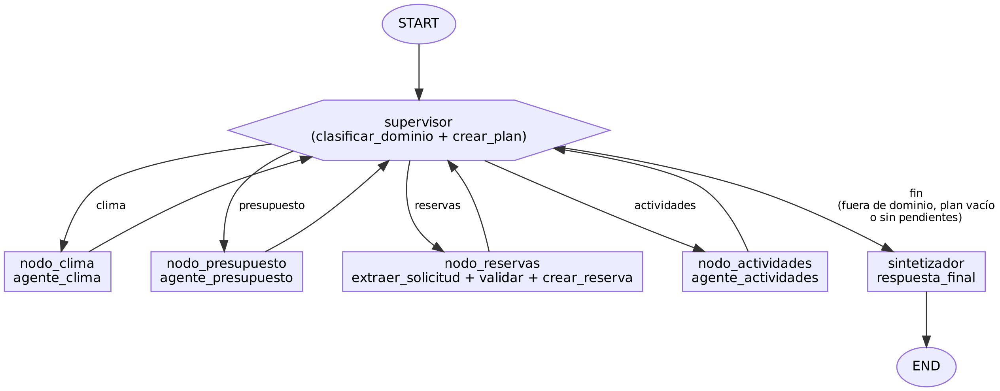

# Planeador de fin de semana multiagente con LangGraph y Ollama

## Descripción

Este proyecto implementa un sistema multiagente para planear salidas de fin de semana a destinos cercanos a Bogotá. Utiliza LangGraph para coordinar agentes especializados y Ollama para ejecutar localmente el modelo de lenguaje Qwen 2.5.

El sistema permite consultar condiciones climáticas simuladas, calcular presupuestos, verificar disponibilidad, realizar reservas y recomendar actividades turísticas.

## Tecnologías utilizadas

- Python
- LangGraph y LangChain
- Ollama (qwen2.5:3b)
- FastAPI
- Docker y Docker Compose
- Nginx
- HTML y JavaScript

## Arquitectura del sistema

El sistema está compuesto por un supervisor, cuatro agentes especializados y un sintetizador.

| Componente | Función |
|---|---|
| Supervisor | Clasifica la consulta y determina qué agentes ejecutar. |
| Agente de Clima | Consulta pronósticos meteorológicos simulados. |
| Agente de Presupuesto | Calcula costos y saldos disponibles. |
| Agente de Reservas | Verifica cupos, valida condiciones y crea reservas. |
| Agente de Actividades | Recomienda actividades turísticas según el destino. |
| Sintetizador | Integra los resultados y genera una respuesta final. |

### Diagrama del grafo

El diagrama de la arquitectura está disponible en:

- [Ver código Mermaid](docs/grafo_planeador.mmd)

## Requisitos previos

Para ejecutar el sistema se necesita:

- Docker Desktop instalado y en funcionamiento.
- Docker Compose.
- Recursos suficientes para ejecutar localmente el modelo qwen2.5:3b.

No es necesario instalar Python ni Ollama directamente en el equipo cuando se utiliza Docker Compose.

## Instalación y ejecución

**1. Clonar el repositorio**

Clonar el repositorio Git del proyecto y acceder a la carpeta `planeador-langgraph`.

**2. Levantar los contenedores**

Desde la carpeta principal, ejecutar:

`docker compose up -d --build`

Este comando inicia los servicios de la API, Ollama y el frontend.

**3. Descargar el modelo de lenguaje**

Si el modelo aún no está descargado en el contenedor de Ollama, ejecutar:

`docker compose exec ollama ollama pull qwen2.5:3b`

**4. Verificar los contenedores**

Ejecutar:

`docker compose ps`

Los servicios deben encontrarse en ejecución.

**5. Abrir la aplicación**

Acceder desde el navegador a:

http://localhost:8080

Desde esta interfaz es posible realizar consultas al sistema multiagente.

## Funcionamiento

El usuario escribe una consulta desde el frontend. FastAPI recibe la petición y la envía al grafo de LangGraph.

El supervisor identifica las intenciones de la consulta y selecciona los especialistas necesarios. Cada agente utiliza sus herramientas para obtener información de los datos simulados.

Una vez completado el plan, el sintetizador reúne los resultados y genera la respuesta que se muestra al usuario.

## Ejemplos de consultas

**Clima:**

¿Cómo estará el clima en Guatavita el domingo?

**Presupuesto:**

Somos 4 personas y tenemos $350.000 para ir a Zipaquirá. ¿Nos alcanza?

**Reserva condicional:**

Queremos ir a Suesca el sábado, somos 3 personas y tenemos $250.000. Si hay poca probabilidad de lluvia y el dinero alcanza, realiza una reserva a nombre de Laura.

**Actividades:**

¿Qué actividades puedo realizar en Suesca?

**Consulta multiagente:**

¿Cómo estará el clima y qué actividades puedo realizar en Guatavita el domingo?

## Pruebas

Se realizaron seis pruebas principales para validar la selección de agentes, los cálculos de presupuesto, la creación de reservas y el manejo de preguntas fuera del dominio.

Durante el desarrollo se detectaron errores en la selección de especialistas y la extracción de información. Estos problemas se abordaron mediante ajustes en los prompts, planificación por intenciones y validaciones adicionales.

También se verificó el funcionamiento del nuevo Agente de Actividades desde la interfaz web.

Los resultados, tiempos de ejecución, errores y evidencias están
documentados en el [informe del proyecto](docs/Informe_Taller_LangGraph.pdf).
## Limitaciones conocidas

- El modelo puede cometer errores al interpretar solicitudes o seleccionar agentes.
- Las consultas multiagente pueden presentar tiempos de respuesta elevados.
- El sintetizador puede generar recomendaciones inconsistentes cuando combina resultados de diferentes especialistas.
- Los datos de clima, costos, cupos y actividades son simulados y no corresponden a información en tiempo real.
- Las reservas se almacenan en memoria y no constituyen reservas reales.

## Detener el sistema

Para detener los contenedores:

`docker compose down`

## Integrantes

- Jeison Miguel Gómez Gómez
- Juan Diego Moreno Alayón
- Mariana Landínez Restrepo

**Asignatura:** Aplicaciones basadas en grandes modelos de lenguaje.

**Universidad:** Universidad El Bosque.